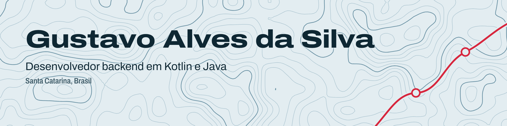

<picture>
  <source media="(prefers-color-scheme: dark)" srcset="assets/banner-dark.png">
  
</picture>

 

Desenvolvedor backend em **Kotlin e Java**. Hoje cuido da sustentação de sistemas de automação contábil na **Ottimizza**. Antes, passei dois anos num ERP em produção na **Lince Tech**, onde aprendi SQL a fundo e a manter um sistema funcionando.

Gosto de problemas com regra de negócio de verdade: um regulamento de 15 páginas, uma operação de coletas, dados eleitorais públicos.

**[Portfólio](https://gustavo-domingos.github.io/portifolio_pessoal/)** &nbsp;&nbsp;&nbsp; **[LinkedIn](https://www.linkedin.com/in/gustavo-alves-da-silva1)** &nbsp;&nbsp;&nbsp; **[Currículo em PDF](https://gustavo-domingos.github.io/portifolio_pessoal/cv/Gustavo-Alves-da-Silva-Curriculo-Desenvolvedor-Backend.pdf)** &nbsp;&nbsp;&nbsp; alvesdasilvag185@gmail.com

## Projetos

| Projeto | Sobre |
|---|---|
| **[Quem eu voto](https://github.com/gustavo-domingos/quem-eu-voto)** Go, React, Docker | Transparência eleitoral com dados abertos do TSE, da Câmara, do Senado e da CGU. API em Go sem banco de dados, zips de vários gigabytes lidos por HTTP Range e camadas verificadas por teste. |
| **[Rotas & Coletas](https://gustavo-domingos.github.io/portifolio_pessoal/#case-rotas-coletas)** Kotlin, Spring Boot, Exposed, React | Coletas e viagens de uma transportadora: a NF-e chega por e-mail e vira solicitação, o cliente acompanha pelo portal e o motorista confirma cada parada no celular. Em implantação. |
| **[Horas Complementares](https://gustavo-domingos.github.io/portifolio_pessoal/#case-horas-complementares)** Kotlin, Spring Boot, Flyway, React | Atividades complementares de uma instituição de ensino: 16 regras tiradas do regulamento e um motor de cálculo que só passa no build com 100% de cobertura de testes. Em implantação. |
| **[CRM Delice](https://gustavo-domingos.github.io/portifolio_pessoal/#case-crm-delice)** Kotlin, Spring Boot, Exposed, React | Trabalho de conclusão de curso, feito em equipe com dois amigos. CRM com integração ao Zoho; fiz o dashboard, as campanhas e o tratamento de exceções. |

Os sistemas em implantação têm repositório privado. Os links levam ao case no portfólio, com prints de dados fictícios.

## Stack

<picture>
  <source media="(prefers-color-scheme: dark)" srcset="https://skillicons.dev/icons?i=kotlin%2Cjava%2Cspring%2Cgo%2Cts%2Creact%2Cmysql%2Cdocker%2Caws%2Cgithubactions%2Cgit&theme=dark">
  
</picture>

Também no dia a dia: SQL Server, Exposed, Flyway, JUnit 5, MockK, Testcontainers, Elastic, Jira e Salesforce.

## Agora

- Sustentação de sistemas contábeis em produção na Ottimizza: bugs, código legado, logs no Elastic e deploys na AWS.
- Implantação do Rotas & Coletas e do Horas Complementares.
- Estudo de arquitetura de software.

Fora do código: bicicleta, academia, HQs, manhwas e livros. Sempre tem alguma ferramenta nova sendo testada.

<b>In English</b>

 

Backend developer working with **Kotlin and Java**, based in southern Brazil. I currently support accounting automation systems in production at **Ottimizza**. Before that, I spent two years on a proprietary ERP at **Lince Tech**, where I learned SQL in depth.

Highlights: **[Quem eu voto](https://github.com/gustavo-domingos/quem-eu-voto)**, an election transparency platform in Go built on open government data, and two Kotlin systems being rolled out for a freight company and a school.

**[Portfolio in English](https://gustavo-domingos.github.io/portifolio_pessoal/?lang=en)** &nbsp;&nbsp;&nbsp; **[Résumé (PDF)](https://gustavo-domingos.github.io/portifolio_pessoal/cv/Gustavo-Alves-da-Silva-Resume-Backend-Developer.pdf)**

